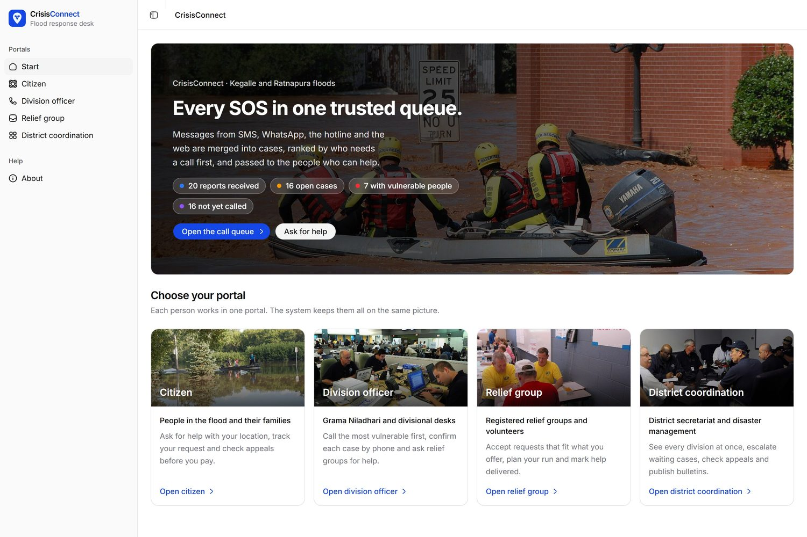
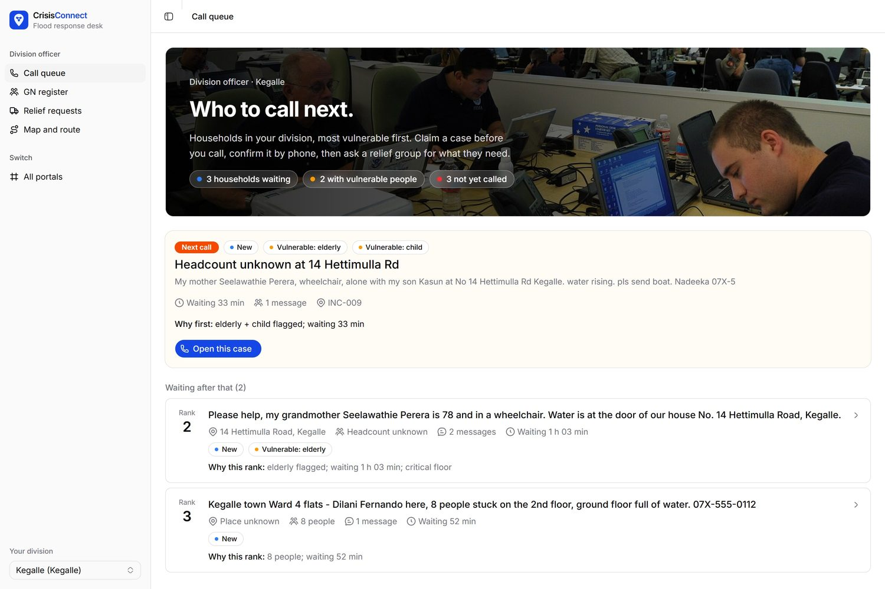
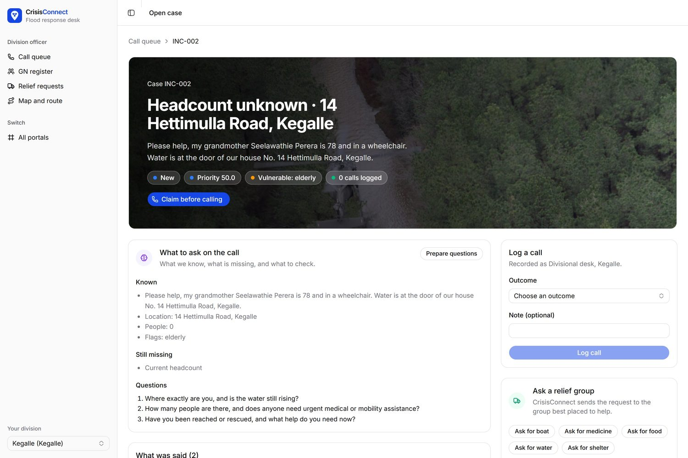
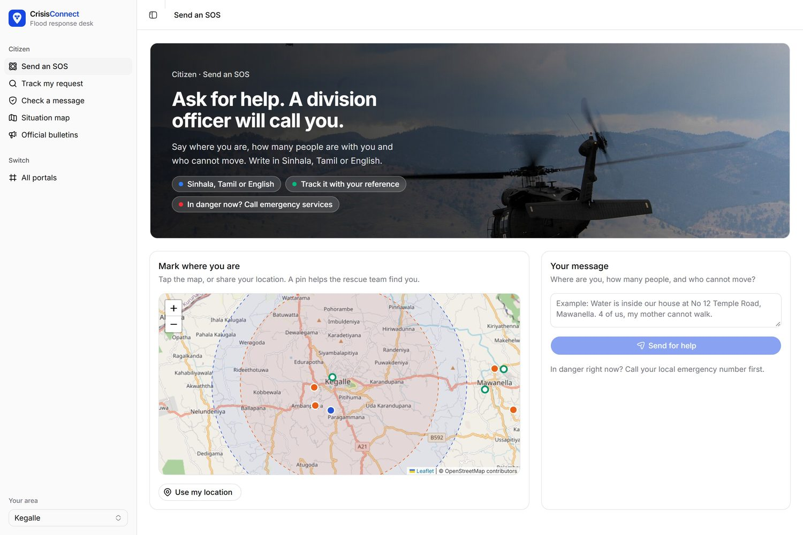
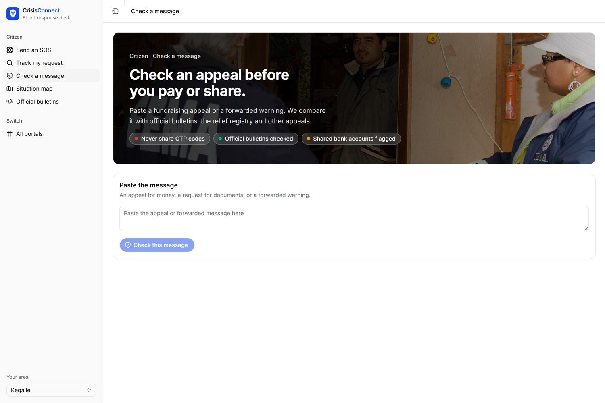
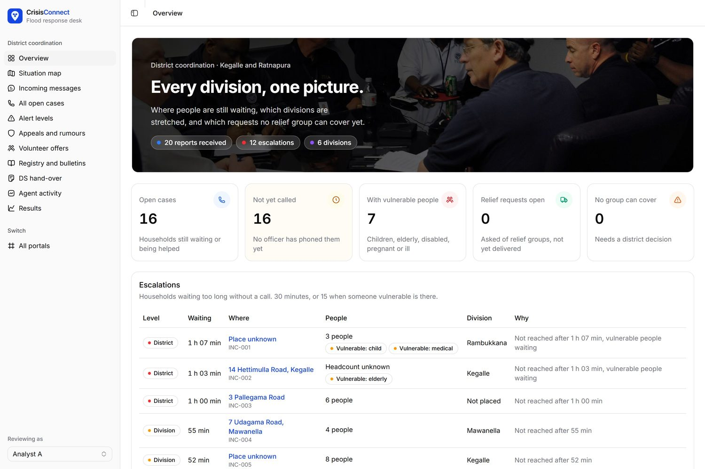
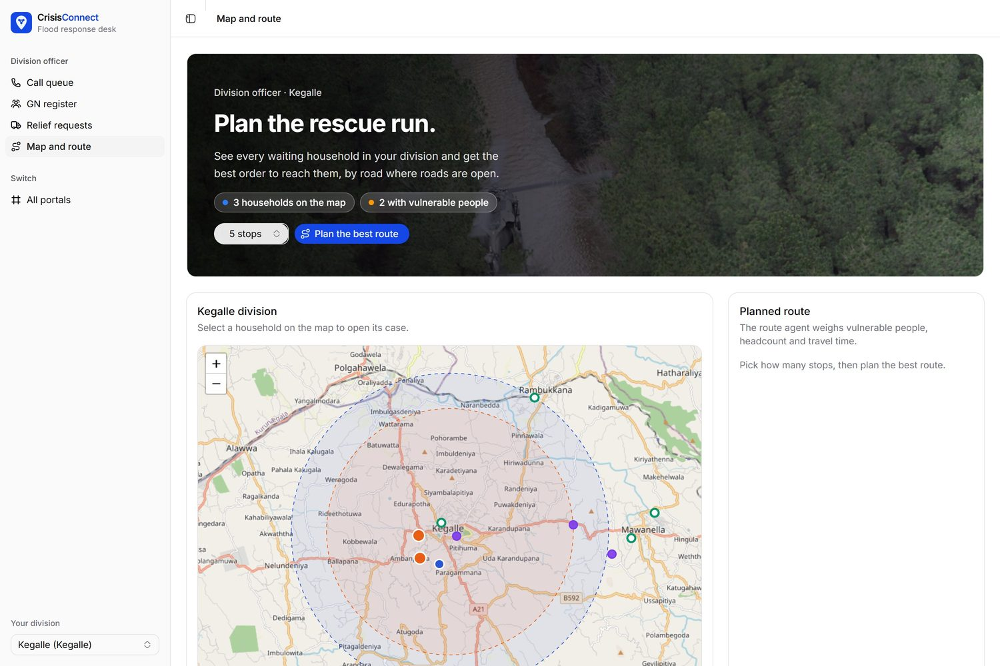
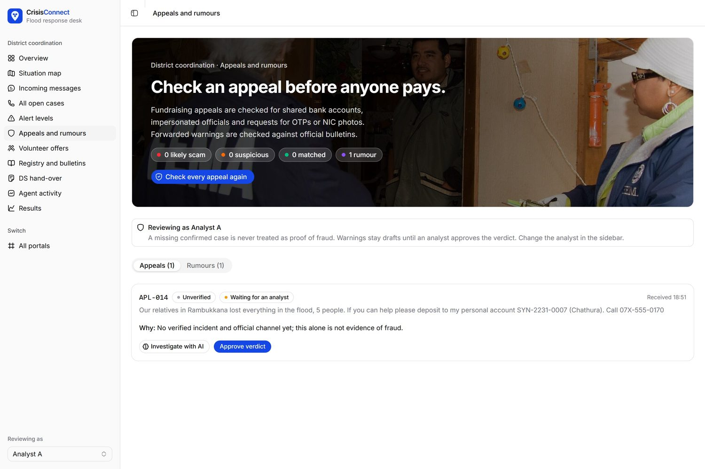
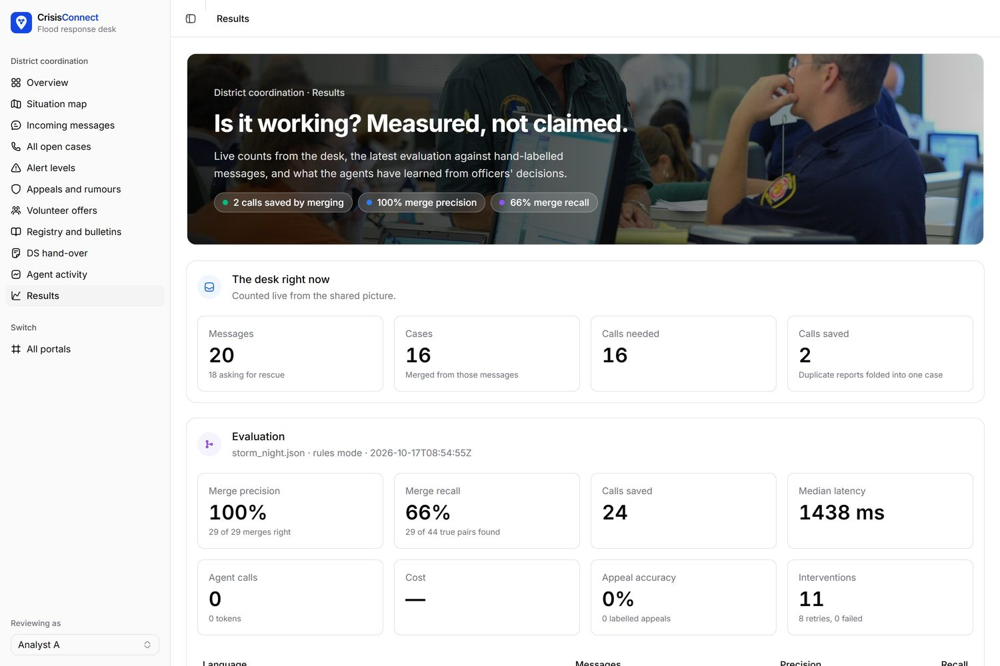
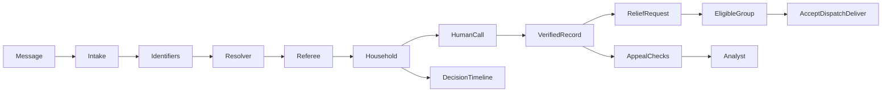

<div align="center">


# CrisisConnect

**Every SOS in one trusted queue.**

One verified household record, from first SOS to relief and appeal checks.

[Live app](https://preview-jac-sbx-cd4e1dc040734b5c8ad09986a0e011cc.jachammer.app) ·
[Pitch deck](docs/CrisisConnect.pptx) ·
[How it works](#how-it-works) ·
[Results](#results) ·
[Run it](#run-it-locally)




</div>

Built by **TheByteForce** during **AI Hackathon 2026** at the University of Moratuwa. All demonstration households, contacts, organisations and bulletins are fictional.

- **Live app:** https://preview-jac-sbx-cd4e1dc040734b5c8ad09986a0e011cc.jachammer.app (Jac Hammer sandbox, synthetic data). The first visit takes in the opening backlog of reports, so allow about 30 seconds.
- **Pitch deck:** [`docs/CrisisConnect.pptx`](docs/CrisisConnect.pptx) (17 slides, with speaker notes)
- **Demo video:** _link added at submission_

## Contents

- [The problem](#the-problem)
- [What CrisisConnect does](#what-crisisconnect-does)
- [Four portals](#four-portals)
- [How it works](#how-it-works)
- [Why Jac and Jaseci](#why-jac-and-jaseci)
- [Results](#results)
- [Run it locally](#run-it-locally)
- [Seven-step demonstration](#seven-step-demonstration)
- [Validation and evaluation](#validation-and-evaluation)
- [Project layout](#project-layout)
- [Deployment](#deployment)
- [Practical boundaries](#practical-boundaries)
- [What's next](#whats-next)

## The problem

In a crisis, the same family shows up in many messages: an SMS, a relative's WhatsApp, a hotline call. Volunteers phone every one of them to confirm the location, needs and headcount, so the most vulnerable people get buried under repeats. During the 2025 floods, one volunteer platform alone took requests from more than 300,000 people.

Fake relief appeals spread through the same channels. One posing as a deputy minister collected about Rs 600,000, and a false dam-breach rumour tied up the emergency hotline with hundreds of calls.

The information exists. What's missing is coordination.

## What CrisisConnect does

**CrisisConnect merges duplicate pleas into one verified household record and ranks who to call next: the most vulnerable first, with a three-question call brief. It routes relief to a registered group and checks donation appeals against the households an officer has verified by phone.** An unverified appeal is never treated as fraud.

| | |
|---|---|
| **Merge** | Messages that share a phone number, a full name or a household-level place become one incident. A shared surname or road is never enough. |
| **Rank** | Elderly, child, medical, disabled and pregnant flags lift a household. Every rank says why, in words. |
| **Verify** | An officer claims the case and confirms it by phone. A missed call never verifies anything. |
| **Deliver** | A relief request goes to an eligible registered group. A decline reassigns it, and the citizen sees when help is on the way and when it is delivered. |
| **Protect** | Citizens and analysts check appeals against official bulletins, the relief registry and verified households before anyone pays. |

**Who it's for:** Grama Niladhari and divisional desk officers making the calls, registered relief groups, district coordinators, and families in the crisis, who can track their own request.

## Four portals

Each person works in one portal, and every portal reads the same graph.

| Portal | Route | For | What they do |
|---|---|---|---|
| Citizen | `/citizen` | People affected and their families | Send an SOS in Sinhala, Tamil or English, track it by reference, read bulletins, check an appeal |
| Division officer | `/officer` | Grama Niladhari and divisional desks | Work the ranked call queue, verify households by phone, request relief, plan the rescue route |
| Relief group | `/ngo` | Registered NGOs and volunteers | Accept or decline requests that fit, dispatch, mark help delivered |
| District coordination | `/district` | District secretariat and disaster management | Monitor escalations, alert levels, appeals, agent activity, bulletins and results |

<table>
  <tr>
    <td width="50%"><br /><sub><b>Officer call queue.</b> Most vulnerable first, with the reason on every card.</sub></td>
    <td width="50%"><br /><sub><b>Case page.</b> A three-question call brief, the call log and relief requests.</sub></td>
  </tr>
  <tr>
    <td><br /><sub><b>Citizen SOS.</b> Pin a location, write in any language, get a reference.</sub></td>
    <td><br /><sub><b>Check a message.</b> Compare an appeal with official bulletins and the registry before paying.</sub></td>
  </tr>
  <tr>
    <td><br /><sub><b>District overview.</b> Escalations: 30 minutes without a call, or 15 when someone vulnerable is waiting.</sub></td>
    <td><br /><sub><b>Rescue run.</b> The route agent weighs vulnerable people, headcount and travel time.</sub></td>
  </tr>
  <tr>
    <td><br /><sub><b>Appeals and rumours.</b> Shared payees, impersonated officials and OTP requests go to an analyst.</sub></td>
    <td><br /><sub><b>Results.</b> Live counts from the desk alongside the latest evaluation.</sub></td>
  </tr>
</table>

## How it works

**AI proposes. Rules referee. People decide.**



1. **Read.** Each SOS, update, offer or appeal is read into the same fields: who, how many, where, which phone, who is vulnerable.
2. **Match.** Walkers find messages that share a phone, a full name or a household-level place.
3. **Referee.** Clear matches merge. Unclear ones wait for a person. Nothing merges on a guess.
4. **Rank.** Open incidents are ranked by risk, vulnerable people and waiting time, with reasons.
5. **Verify.** An officer claims the case and confirms it by phone.
6. **Dispatch.** An eligible relief group accepts. A decline reassigns the request.
7. **Deliver.** Delivery is recorded, and the citizen's tracking updates.

## Why Jac and Jaseci

A household in a crisis is a graph: messages, phones, names, calls, appeals and relief requests, all connected. So we built on one.

Messages, identifiers, incidents, calls, appeals and resource requests share a persistent graph anchored explicitly on `root.shared`. Walkers find candidates through shared identifiers. The resolver uses `visit ... by llm` to choose a graph neighbour, and a typed scoring function to assess the household match. Typed `by llm` functions handle intake, briefing and resource matching. Tool-using agents inspect read-only evidence. Plain Jac referee rules constrain automatic actions, while humans verify calls and review consequential findings. Decision nodes preserve the reasoning and outcome, and `commit()` makes each completed unit visible to other requests. The frontend is also written in Jac.

```jac
walker Resolver {
    can start with Message entry {
        visit [->:Candidate:->] by resolver_model(
            intent="Choose the most plausible household for this message. Exact phones and a full name plus household place are strong evidence. Same surname or road is insufficient.",
            select=1
        );
    }
}
```

<sub>Shortened from <a href="crisisconnect/ai/resolver.jac"><code>crisisconnect/ai/resolver.jac</code></a>.</sub>

- **Agents:**
  - *Intake:* typed `by llm`, with canonical names and phones.
  - *Resolver:* `visit [->:Candidate:->] by llm` plus a typed scorer, retried once with the referee's block reason.
  - *Call brief:* typed, exactly three questions.
  - *Ranker:* a ReAct agent capped at 4 iterations. It explains the top five but can never push a vulnerable household below its deterministic score.
  - *Appeal investigator:* `visit [-->] by llm` picks which lead to check first (payee, phone, link, claimed office or household). A ReAct agent with five read-only tools then cites what it found.
- **Referee:** fourteen plain Jac rules (R1–R14), each with a test. Nothing an agent proposes changes the graph until a rule allows it or a person approves it.

  | Rule | Guarantee |
  |---|---|
  | R1–R2 | A merge needs shared evidence: an exact phone, or a full name plus a household-level place |
  | R3 | A model can never lower the priority of a medical, child or elderly case |
  | R4 | Confirmed and resolved need a logged phone call |
  | R5 | Two desks cannot claim the same incident |
  | R6 | A contradiction in headcount or location re-opens verification |
  | R7 | Rumours never enter the call queue |
  | R11 | Sinhala and Tamil warning drafts stay marked for a native speaker's check |
  | R12 | Real people's names and real office titles never appear in fixtures or generated warnings |
  | R13 | Every applied change carries a Decision with agent, action and reason |
  | R14 | Model tools are read-only. Only the single writer applies changes |

- **Agent memory in the same graph:** a memory hub keeps one run per message with its ordered steps. It records every model call (model, latency, tokens), the rule each decision cites, desk feedback on merge proposals, and a usage ledger that survives resets. The resolver reads tonight's desk precedents as evidence, in the form of counts, never old message text.
- **Reliability:**
  - a fallback model pool;
  - a spend and call cap;
  - a rules-only mode, in which phone-match merges and the priority score keep working with every model down;
  - a labelled recorded run of real model outputs.
- **Storage:** the whole graph (the crisis night and the agents' memory) lives in the Postgres that Jac Hammer provisions. There is no separate database.
- **Observability:** native Jac tracing, metrics and logs. See [`observability/README.md`](observability/README.md).

## Results

There are three completed runs of the integrated 94-message fixture. Each JSON includes pairwise counts, engine, timestamp, language groups and unavailable measurements.

- [`results/development-rules.json`](results/development-rules.json): rules only, no model.
- [`results/development-live.json`](results/development-live.json): live Gemini 2.5 Flash agents, 17 Oct 2026.
- [`results/development-cached.json`](results/development-cached.json): the same live outputs re-scored from the recorded run. This adds appeal accuracy.

| Development fixture (94 synthetic messages, 64 rescue) | Rules only | Live model agents |
|---|---|---|
| Calls needed (incidents) | 40, **24 calls saved** | 39, **25 calls saved** |
| Merge precision (no wrong merges) | **100%** (29 of 29 pairs) | **100%** (38 of 38 pairs) |
| Merge recall | 65.9% (29 of 44 pairs) | **86.4%** (38 of 44 pairs) |
| Message kind accuracy | 81.9% | **92.6%** |
| Referee interventions | 11 blocks or hand-offs, 8 retries | 24 blocks or hand-offs, 8 retries |
| Appeal verdict accuracy (20 labelled appeals) | not measured | **70%** (14 of 20) |
| Model calls, cost, median time per message | none | 189 calls, US$0.35 for the night, 9.1 s |
| Failed messages | 0 | 0 |

The agents find a third more of the true duplicates than the rules alone, and still make no wrong merge: the referee blocked every unsafe proposal. These are development numbers on synthetic data the team wrote, not held-out performance.

**Recorded run:** [`crisisconnect/fixtures/recorded_run.json`](crisisconnect/fixtures/recorded_run.json) holds the real model outputs from the live run (94 intake results, 7 appeal investigations). With `CRISISCONNECT_CACHE_MODE=cached`, the app replays them and every screen says "Cached replay · live on cache miss". It is a demo backup for when the model is unreachable, and is never presented as live.

## Run it locally

Use Linux or WSL with Jac **0.37.25**. Keep the checkout in the Linux filesystem.

```bash
jac install
export GEMINI_API_KEY="your-local-key"
jac run --dev
```

| Variable | Effect |
|---|---|
| `CRISISCONNECT_AI=off` | Deterministic, rules-only demonstration |
| `CRISISCONNECT_AI=on` | Model-backed agents |
| `CRISISCONNECT_CACHE_MODE=cached` | Replay the labelled recorded run, live on a cache miss |

Never commit keys or `.env` files.

Open the local address printed by Jac:

- `/citizen`: send an SOS, track its reference, read bulletins and check appeals.
- `/officer`: select a division, verify households by phone and request relief.
- `/ngo`: accept, decline, dispatch and deliver requests for a registered group.
- `/district`: monitor escalations, appeals, agent activity and evaluation.
- `/officer?ops`: guided demonstration controls. "Start over" resets the synthetic demonstration data.

## Seven-step demonstration

1. An SMS and a relative's WhatsApp become one household incident.
2. A different Perera household remains separate.
3. A missed call does not verify the household; a successful call does.
4. A boat request goes to an eligible registered group. Its decline triggers reassignment.
5. The next group accepts and dispatches; the citizen can see that help is on the way.
6. An appeal through the registered channel matches the verified household. An unregistered payee plus an OTP request triggers analyst review.
7. The group records delivery, and citizen tracking updates to "Help delivered". Open the household story and the Jac graph to inspect evidence, agent proposals, rules, human decisions and actions.

The operator panel feeds fictional messages and recorded human actions into the real application pipeline. In rules mode, the demonstration does not claim live model inference.

## Validation and evaluation

```bash
jac check .
jac test crisisconnect
jac run --faux
jac run --no-serve --no-takeover tools/evaluate.jac --mode rules
```

Evaluation reads the raw messages first and opens the separate truth labels only after predictions are produced. Results identify the engine and dataset. The bundled storm night is development data, not independent held-out evidence. A separately authored set can be supplied with message and label paths; use `--held-out` only when that independence is true. No production-performance claim is made.

## Project layout

```text
main.jac                 app entry point
pages/                   routed pages: citizen, officer, ngo, district, about
components/              Jac UI components (jac-shadcn primitives, map, timeline)
crisisconnect/           engine: coordinator, blocking, referee, portal, casework,
                         timeline, scenario, memory, geo, evaluation
crisisconnect/ai/        intake, resolver, call brief, triage, model pool
crisisconnect/fixtures/  storm night, truth labels, registry, GN register, recorded run
results/                 recorded development evaluations
tools/                   evaluation runner
observability/           tracing, metrics and logs setup
docs/                    pitch deck and screenshots
assets/                  logo and public-domain photos (credits on /about)
```

## Deployment

Deploy the release commit rather than an earlier dashboard copy. Verify that `/functions` includes `scenario_next`, `citizen_send`, `household_timeline`, `respond_request` and `map_layers`. The existing sandbox must be republished through its authorised Jac Hammer account; a local build passing is not proof that the remote revision matches.

## Practical boundaries

- Role selection is a demonstration workflow, not authenticated production authorisation.
- An unverified appeal is not evidence of fraud; public warnings require review.
- Map locations inferred from a division are approximate. Road routing does not establish safe access; straight-line fallback estimates are labelled.
- Human decision precedents are retrieved graph memory, not model fine-tuning.
- A recorded model run must be labelled; unseen inputs may still invoke the live provider.
- Real deployment requires access controls, verified relief registries, operational data feeds and field validation.
- Fixtures and seeded bulletins use invented issuers. Referee rule R12 has a test that fails if a real agency's name appears in any fixture or seeded bulletin.
- Sinhala and Tamil messages in the fixture need a native speaker's check. Warning drafts in those languages stay marked "needs native-speaker check" (R11) until one approves them.
- Data minimisation: CrisisConnect keeps only what a call needs (names, phones, place, headcount, needs), and nothing from appeals beyond the evidence cited. A production version would mask resolved households after the emergency.

## What's next

- An SMS gateway and a WhatsApp webhook feeding the same intake, so people without mobile data can reach the desk.
- Verified relief registries and official bulletin feeds in place of the fictional registry.
- Officer logins per division, and a print-ready hand-over sheet for each Divisional Secretariat.
- An independent, separately written held-out set to measure merge and appeal accuracy.
- Beyond floods: landslides, cyclones and any crisis where people need to be found, verified and reached.

## Credits and license

Photos are public-domain FEMA, National Guard and NASA images from Wikimedia Commons; full credits are on the app's `/about` page.

MIT licensed. See [LICENSE](LICENSE).
