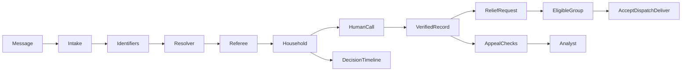

# CrisisConnect

**One verified household record, from first SOS to relief and appeal checks.**

Built by TheByteForce during AI Hackathon 2026 at the University of Moratuwa. All demonstration households, contacts, organisations and bulletins are fictional.

- **Live app:** https://preview-jac-sbx-e4cfaadb8da1492db89a01fdc902a284.jachammer.app (Jac Hammer sandbox, synthetic data; the first visit takes in the opening backlog of reports, so allow about 30 seconds)
- **Demo video:** _link added at submission_

## The problem

On a flood night, the same family appears in many messages: an SMS, a relative's WhatsApp, a hotline call. Volunteers phone every one of them to confirm the location, needs and headcount, so the most vulnerable people get buried under repeats. During the 2025 floods one volunteer platform alone took requests from more than 300,000 people. Fake relief appeals ride the same channels: one posing as a deputy minister collected about Rs 600,000, and a false dam-breach rumour tied up the emergency hotline with hundreds of calls.

**CrisisConnect merges duplicate pleas into one verified household record, ranks who to call next (most vulnerable first, with a three-question call brief), routes relief to a registered group, and checks donation appeals against the households an officer verified by phone.** Unverified is never treated as fraud.

Who it's for: Grama Niladhari and divisional desk officers making the calls, registered relief groups, district coordinators, and families in the flood, who can track their own request.

## Run

Use Linux or WSL with Jac **0.37.25**. Keep the checkout in the Linux filesystem.

```bash
jac install
export GEMINI_API_KEY="your-local-key"
jac run --dev
```

For a deterministic demonstration use `export CRISISCONNECT_AI=off` before starting. For model-backed operation use `CRISISCONNECT_AI=on`. Never commit keys or `.env` files.

Open the local address printed by Jac:

- `/citizen`: send an SOS, track its reference, read bulletins and check appeals.
- `/officer`: select a division, verify households by phone and request relief.
- `/ngo`: accept, decline, dispatch and deliver requests for a registered group.
- `/district`: monitor escalations, appeals, agent activity and evaluation.
- `/officer?ops`: guided demonstration controls. Start over resets synthetic demonstration data.

## Seven-step demonstration

1. An SMS and a relative's WhatsApp become one household incident.
2. A different Perera household remains separate.
3. A missed call does not verify the household; a successful call does.
4. A boat request goes to an eligible registered group. Its decline triggers reassignment.
5. The next group accepts and dispatches; the citizen can see that help is on the way.
6. An appeal through the registered channel matches the verified household. An unregistered payee plus an OTP request triggers analyst review.
7. The group records delivery. Citizen tracking updates to Help delivered. Open the household story and Jac graph to inspect evidence, agent proposals, rules, human decisions and actions.

The operator panel supplies fictional messages and recorded human actions to the real application pipeline. In rules mode, the demonstration does not claim live model inference.

## Why Jac and Jaseci

Messages, identifiers, incidents, calls, appeals and resource requests share a persistent graph anchored explicitly on `root.shared`. Walkers find candidates through shared identifiers. The resolver uses `visit ... by llm` to choose a graph neighbour and a typed scoring function to assess the household match. Typed `by llm` functions perform intake, briefing and resource matching. Tool-using agents inspect read-only evidence. Plain Jac referee rules constrain automatic actions, while humans verify calls and review consequential findings. Decision nodes preserve the reasoning and outcome; `commit()` makes each completed unit visible to other requests. The frontend is also written in Jac.

- **Agents:** intake (typed `by llm`, canonical names and phones), resolver (`visit [->:Candidate:->] by llm` plus a typed scorer, retried once with the referee's block reason), call brief (typed, exactly three questions), ranker (a ReAct agent capped at 4 iterations that explains the top five but can never push a vulnerable household below its deterministic score), and appeal investigator (`visit [-->] by llm` picks which lead to check first — payee, phone, link, claimed office or household — then a ReAct agent with five read-only tools cites what it found).
- **Referee:** fourteen plain Jac rules (R1–R14), each with a test. Nothing an agent proposes changes the graph until a rule allows it or a person approves it.
- **Agent memory in the same graph:** a memory hub keeps one run per message with its ordered steps, every model call (model, latency, tokens), the rule each decision cites, desk feedback on merge proposals and a usage ledger that survives resets. The resolver reads tonight's desk precedents as evidence, as counts, never as old message text.
- **Reliability:** a fallback model pool, a spend and call cap, a rules-only mode (phone-match merges and the priority score keep working with every model down), and a labelled recorded run of real model outputs.
- **Storage:** the whole graph (the flood night and the agents' memory) lives in the Postgres that Jac Hammer provisions. There is no separate database.



Key modules: `coordinator`, `blocking`, `referee`, `portal`, `casework`, `timeline`, `scenario`, `memory`, `geo`, and `evaluation` under `crisisconnect/`.

## Validation and evaluation

```bash
jac check .
jac test crisisconnect
jac run --faux
jac run --no-serve --no-takeover tools/evaluate.jac --mode rules
```

Evaluation reads raw messages first and opens the separate truth labels only after predictions are produced. Results identify the engine and dataset. The bundled storm night is development data, not independent held-out evidence. A separately authored set can be supplied with message and label paths; use `--held-out` only when that independence is true. No production-performance claim is made.

## Practical boundaries

- Role selection is a demonstration workflow, not authenticated production authorisation.
- An unverified appeal is not evidence of fraud; public warnings require review.
- Map locations inferred from a division are approximate. Road routing does not establish flood-safe access; straight-line fallback estimates are labelled.
- Human decision precedents are retrieved graph memory, not model fine-tuning.
- A recorded model run must be labelled; unseen inputs may still invoke the live provider.
- Real deployment requires access controls, verified relief registries, operational data feeds and field validation.
- Fixtures and seeded bulletins use invented issuers. Referee rule R12 has a test that fails if a real agency's name appears in any fixture or seeded bulletin.
- Sinhala and Tamil messages in the fixture need a native speaker's check; warning drafts in those languages stay marked "needs native-speaker check" (R11) until one approves them.
- Data minimisation: CrisisConnect keeps only what a call needs (names, phones, place, headcount, needs) and nothing from appeals beyond the evidence cited. A production version would mask resolved households after the emergency.

## What's next

- An SMS gateway and a WhatsApp webhook feeding the same intake, so people without data can reach the desk.
- Verified relief registries and official bulletin feeds in place of the fictional registry.
- Officer logins per division, and a print-ready hand-over sheet for each Divisional Secretariat.
- An independent, separately written held-out set to measure merge and appeal accuracy.

MIT licensed. See [LICENSE](LICENSE).


## Recorded development results

Two completed runs of the integrated 94-message fixture: `results/development-rules.json` (rules only, no model) and `results/development-live.json` (live Gemini 2.5 Flash agents, 17 Oct 2026). Pairwise counts, engine, timestamp, language groups and unavailable measurements are in each JSON.

| Development fixture (94 synthetic messages, 64 rescue) | Rules only | Live model agents |
|---|---|---|
| Calls needed (incidents) | 40, **24 calls saved** | 39, **25 calls saved** |
| Merge precision (no wrong merges) | **100%** (29 of 29 pairs) | **100%** (38 of 38 pairs) |
| Merge recall | 65.9% (29 of 44 pairs) | **86.4%** (38 of 44 pairs) |
| Message kind accuracy | 81.9% | **92.6%** |
| Referee interventions | 11 blocks or hand-offs, 8 retries | 24 blocks or hand-offs, 8 retries |
| Model calls, cost, median time per message | none | 189 calls, US$0.35 for the night, 9.1 s |
| Failed messages | 0 | 0 |

The agents find a third more of the true duplicates than the rules alone, with still no wrong merge: the referee blocked every unsafe proposal. These are development numbers on synthetic data the team wrote, not held-out performance.

**Recorded run:** `crisisconnect/fixtures/recorded_run.json` holds the real model outputs from the live run (94 intake results, 7 appeal investigations). With `CRISISCONNECT_CACHE_MODE=cached` the app replays them and every screen says "Cached replay · live on cache miss". It is a demo backup for when the model is unreachable, never presented as live.

## Deployment

Deploy the release commit rather than an earlier dashboard copy. Verify `/functions` includes `scenario_next`, `citizen_send`, `household_timeline`, `respond_request` and `map_layers`. The existing sandbox must be republished through its authorised Jac Hammer account; a local build passing is not proof that the remote revision matches.
