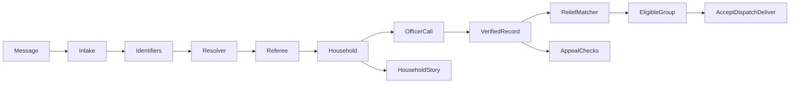

<div align="center">


# CrisisConnect

**Every SOS in one trusted queue.**

Every flood SOS becomes one verified household, and that verified record then guides rescue, relief and donation safety.

[Live app](http://3.107.243.34) ·
[Guided demo](http://3.107.243.34/officer?ops) ·
[Live graph](http://3.107.243.34/graph) ·
[Pitch deck](docs/CrisisConnect.pptx) ·
[Results](#results) ·
[For reviewers](#for-reviewers)


</div>

Built by **TheByteForce** at **AI Hackathon 2026** (Jaseci Labs × EESoc, University of Moratuwa), written in Jac on Jaseci.

- **Live app:** http://3.107.243.34 (mirror: [Jac Hammer sandbox](https://preview-jac-sbx-cd4e1dc040734b5c8ad09986a0e011cc.jachammer.app))
- **Guided demo:** http://3.107.243.34/officer?ops. Press **Start over**, then **Next step** seven times.
- **Live Jac graph:** http://3.107.243.34/graph
- **Pitch deck:** [`docs/CrisisConnect.pptx`](docs/CrisisConnect.pptx) (17 slides, with speaker notes)
- **Demo video:** _link added at submission_

## Contents

- [Why this matters](#why-this-matters)
- [One household, end to end](#one-household-end-to-end)
- [Four portals, one shared graph](#four-portals-one-shared-graph)
- [The agents](#the-agents)
- [Why Jac and Jaseci](#why-jac-and-jaseci)
- [Results](#results)
- [For reviewers](#for-reviewers)
- [Project layout](#project-layout)
- [Practical boundaries](#practical-boundaries)
- [What's next](#whats-next)

## Why this matters

When floods hit Sri Lanka, help requests arrive faster than any desk can read them. One family in danger sends an SMS, a relative forwards a WhatsApp message, a neighbour calls the hotline. Volunteers phone every message, confirming the same household again and again. Meanwhile the people who cannot move (the elderly, children, people with disabilities) wait in the same queue as everyone else. In the 2025 floods, a single volunteer platform received requests from more than 300,000 people.

The same channels carry fake donation appeals. One posing as a deputy minister collected about Rs 600,000, and a false dam-breach rumour tied up the emergency hotline with hundreds of calls.

**CrisisConnect is AI for good, built for that night.** Its agents:

- read every message in Sinhala, Tamil or English;
- merge the repeats into one household and put the most vulnerable first;
- route relief to a registered group that can actually deliver;
- check donation appeals against the households an officer has verified by phone.

An unverified appeal is never treated as fraud.

> **Agents propose. Rules constrain. People confirm.**

## One household, end to end

The [guided demo](http://3.107.243.34/officer?ops) follows a single family through the whole system. Every step runs the real pipeline.

1. **Two reports, one family.** An SMS and a relative's WhatsApp message arrive. The resolver agent recognises the same household and merges them, so the officer makes one call instead of two.
2. **Same surname, different family.** Another Perera household at a different address stays a separate case. The household story shows the evidence, and the safety rule that kept them apart.
3. **Verified by a person.** The officer's first call goes unanswered, so the household stays unverified and moves up the queue. The second call reaches the family and confirms them. The citizen's tracker updates to *Officer confirmed by phone*.
4. **Relief that adapts.** The officer asks for a boat. The relief matcher sends the request only to registered groups that offer boats and serve that division. The first group declines, and CrisisConnect re-routes the request to the next eligible group automatically.
5. **Help on the way.** The group accepts and sets off. The family sees *Help is on the way* with their reference number.
6. **Safe giving.** Two appeals name the family. The one through a registered relief group is matched to the verified household. The one asking for money to an unregistered account plus an OTP code goes to an analyst as a likely scam.
7. **The whole record.** The household story shows every message, agent proposal, rule check, human decision and action, in order. The live Jac graph shows the nodes and edges behind it.

## Four portals, one shared graph

Each person uses the portal for their role, and every portal reads the same graph.

| Portal | Who | What they do |
|---|---|---|
| **Citizen** `/citizen` | People in the flood and their families | Send an SOS (with a map pin or "use my location"), track it by reference number, check an appeal before donating, read official bulletins, find the nearest shelters |
| **Division officer** `/officer` | Grama Niladhari and divisional desks | Work the division's queue (most vulnerable first, with a three-question call brief), verify households by phone, ask a relief group for help, plan the best rescue run on the map |
| **Relief group** `/ngo` | Registered NGOs and volunteer groups | Receive matched requests with the reason they were chosen, accept or decline, mark on the way and delivered, plan the best delivery run from their base |
| **District coordination** `/district` | District disaster management | See every division, households waiting too long, the situation map, appeals and rumours, bulletins, every agent decision, and the results |

<table>
  <tr>
    <td width="50%"><br /><sub><b>Officer call queue.</b> Most vulnerable first, with the reason on every card.</sub></td>
    <td width="50%"><br /><sub><b>Case page.</b> A three-question call brief, the call log and relief requests.</sub></td>
  </tr>
  <tr>
    <td><br /><sub><b>Citizen SOS.</b> Pin a location, write in any language, get a reference number.</sub></td>
    <td><br /><sub><b>Check a message.</b> Compare an appeal with official bulletins and the registry before donating.</sub></td>
  </tr>
  <tr>
    <td><br /><sub><b>District overview.</b> Escalation after 30 minutes without a call, or 15 when someone vulnerable is waiting.</sub></td>
    <td><br /><sub><b>Rescue run.</b> Three candidate runs; a vulnerable household is never dropped.</sub></td>
  </tr>
  <tr>
    <td><br /><sub><b>Appeals and rumours.</b> Shared payees, impersonated officials and OTP requests go to an analyst.</sub></td>
    <td><br /><sub><b>Results.</b> Live counts from the desk alongside the latest evaluation.</sub></td>
  </tr>
</table>

## The agents

| Agent | What it does | Where |
|---|---|---|
| Intake | Reads each message in any of three languages and returns typed facts: kind, people, vulnerable people, needs, place, phones, names | [`crisisconnect/ai/intake.jac`](crisisconnect/ai/intake.jac) |
| Resolver | Walks the graph to candidate households with `visit [->:Candidate:->] by llm`, scores the match, and retries once with the referee's reason if a rule blocks it | [`crisisconnect/ai/resolver.jac`](crisisconnect/ai/resolver.jac) |
| Ranker | A tool-using ReAct agent (capped at 4 iterations) that explains the top of the queue. A vulnerable household can never drop below its rule-based priority | [`crisisconnect/ai/triage.jac`](crisisconnect/ai/triage.jac) |
| Call brief | Writes exactly three questions for the officer's call | [`crisisconnect/ai/brief.jac`](crisisconnect/ai/brief.jac) |
| Relief matcher | Picks among eligible registered groups for a need and a place, explains why, and re-routes on a decline | [`crisisconnect/portal.jac`](crisisconnect/portal.jac) |
| Route agent | Builds three runs (vulnerable first, most people, shortest drive), orders each on real roads, and picks the one that covers the most. It can never drop a vulnerable household | [`crisisconnect/geo.jac`](crisisconnect/geo.jac) |
| Appeal investigator | Chooses which lead to follow with `visit [-->] by llm`, then checks the registry, shared accounts and the verified household with read-only tools, citing what it found | [`crisisconnect/casework.jac`](crisisconnect/casework.jac) |
| Referee | Fourteen plain Jac rules (R1 to R14) that every agent proposal passes before it changes anything | [`crisisconnect/referee.jac`](crisisconnect/referee.jac) (R8 to R11 in `casework.jac`) |

Every decision is saved as a node in the graph with its reason, model and outcome. That is how the household story and the district's agent activity page show exactly why each step happened ([`crisisconnect/timeline.jac`](crisisconnect/timeline.jac)).

**What the referee guarantees.** Each rule has its own test.

| Rule | Guarantee |
|---|---|
| R1–R2 | A merge needs shared evidence: an exact phone, or a full name plus a household-level place |
| R3 | A model can never lower the priority of a medical, child or elderly case |
| R4 | Confirmed and resolved need a logged phone call |
| R5 | Two desks cannot claim the same incident |
| R6 | A contradiction in headcount or location re-opens verification |
| R7 | Rumours never enter the call queue |
| R10–R11 | No public warning without approval; Sinhala and Tamil drafts also need a native speaker's check |
| R12 | Real people's names and real office titles never appear in fixtures or generated warnings |
| R13 | Every applied change carries a Decision with agent, action and reason |
| R14 | Model tools are read-only. Only the single writer applies changes |

## Why Jac and Jaseci

- **One persistent graph.** Messages, phones, names, places, households, calls, relief requests, appeals and decisions are nodes and typed edges on `root.shared`. A verified household is reused by relief and appeal checks because it is the same node.
- **Walkers as agents.** The resolver and the appeal investigator traverse the graph with `visit ... by llm`, choosing their next step among real neighbours.
- **Meaning-typed AI.** `by llm` functions return typed objects, guided by `sem` notes, so every agent output is structured and checked before use.
- **Agent memory in the graph.** The same graph stores:
  - each message's run, with its ordered steps;
  - every model call (model, latency, tokens);
  - the rule each decision cites;
  - desk feedback on merges;
  - a usage ledger that survives resets.

  The resolver reads tonight's desk precedents as evidence, as counts, never as old message text.
- **`commit()` per unit of work.** Each completed message becomes visible to every other request at once.
- **Full stack in Jac.** The four portals, the map and the guided demo are written in Jac too. Over 98% of the repository is Jac, by GitHub's language bar.

```jac
walker Resolver {
    can start with Message entry {
        visit [->:Candidate:->] by resolver_model(
            intent="Choose the most plausible household for this message. Exact phones and a full name plus household place are strong evidence. Same surname or road is insufficient.",
            select=1
        );
    }
}
```

<sub>Shortened from <a href="crisisconnect/ai/resolver.jac"><code>crisisconnect/ai/resolver.jac</code></a>.</sub>



**Reliability:**

- A fallback model pool, and a cap on spending and calls.
- A rules-only mode: phone-match merges and the priority score keep working with every model down.
- A labelled recorded run of real model outputs.

**Storage:** the whole graph lives in the Postgres that Jac Hammer provisions; there is no separate database.

**Observability:** native Jac traces, metrics and logs ([`observability/README.md`](observability/README.md)).

## Results

Measured on the team's 94-message storm-night fixture (64 rescue messages):

| | Rules only | With AI agents |
|---|---|---|
| Calls saved by merging duplicates | 24 | **25** |
| Merge precision (no wrong merges) | **100%** (29 of 29 pairs) | **100%** (38 of 38 pairs) |
| Duplicates found (recall) | 65.9% (29 of 44 pairs) | **86.4%** (38 of 44 pairs) |
| Message type accuracy | 81.9% | **92.6%** |
| Appeal verdict accuracy (20 labelled appeals) | not measured | **70%** (14 of 20) |
| Referee interventions | 11 blocks or hand-offs, 8 retries | 24 blocks or hand-offs, 8 retries |
| Model calls, median time per message | none | 189 calls, 9.1 s |
| Cost for the whole night | none | **US$0.35** |
| Failed messages | 0 | 0 |

**The agents find a third more of the real duplicates than rules alone, and the referee kept every merge correct.** These are development numbers on synthetic data the team wrote, not held-out performance.

Full outputs are in [`results/`](results):

- `development-rules.json`: rules only.
- `development-live.json`: live Gemini 2.5 Flash, 17 Oct 2026.
- `development-cached.json`: the same live outputs re-scored, which adds appeal accuracy.

The recorded model run is in [`crisisconnect/fixtures/recorded_run.json`](crisisconnect/fixtures/recorded_run.json). With `CRISISCONNECT_CACHE_MODE=cached`, the app replays it and every screen says "Cached replay · live on cache miss". It is a backup for when the model is unreachable, and is never presented as live.

## For reviewers

**Try it.** Open http://3.107.243.34/officer?ops and step through the guided story, or visit `/citizen`, `/officer`, `/ngo` and `/district`. The live graph is at [`/graph`](http://3.107.243.34/graph).

**Run it** (Linux or WSL, Jac 0.37.25; keep the checkout in the Linux filesystem):

```bash
jac install
export CRISISCONNECT_AI=on GEMINI_API_KEY="your-key"     # or CRISISCONNECT_AI=off for rules only
jac run --no-dev --host 0.0.0.0 -p 8000
```

Use `jac run --dev` for hot reload while developing. Never commit keys or `.env` files.

**Check it:**

```bash
jac check .                 # type-checks every module
jac test crisisconnect      # 132 tests, including one per referee rule
jac run --faux              # lists every served endpoint
jac run --no-serve --no-takeover tools/evaluate.jac --mode rules
```

Evaluation reads the raw messages first and opens the separate truth labels only after predictions are produced. The bundled storm night is development data, not independent held-out evidence. Use `--held-out` only with a separately written set.

**Deploying:** deploy the release commit, then confirm that `/functions` includes `scenario_next`, `citizen_send`, `household_timeline`, `respond_request` and `map_layers`. A local build passing does not prove the remote revision matches.

## Project layout

```text
main.jac                 app entry point
pages/                   the four portals and the about page
components/              Jac UI components (jac-shadcn primitives, map, timeline)
crisisconnect/           engine: coordinator, referee, blocking, portal, geo,
                         casework, timeline, scenario, memory, evaluation
crisisconnect/ai/        intake, resolver, call brief, ranker, model pool
crisisconnect/fixtures/  storm night, truth labels, registry, GN register, recorded run
results/                 recorded evaluations
tools/                   evaluation runner
observability/           traces, metrics and logs
docs/                    pitch deck and screenshots
assets/                  logo and public-domain photos (credits on /about)
```

## Practical boundaries

- Role selection is a demonstration workflow, not authenticated production authorisation.
- An unverified appeal is not evidence of fraud; public warnings require review.
- Map locations inferred from a division are approximate. Road routing does not prove safe access; straight-line fallback estimates are labelled.
- Human decision precedents are retrieved graph memory, not model fine-tuning.
- Sinhala and Tamil messages in the fixture need a native speaker's check (R11).
- Data minimisation: only what a call needs is kept (names, phones, place, headcount, needs). A production version would mask resolved households after the emergency.
- Real deployment requires access controls, verified relief registries, operational data feeds and field validation.

## What's next

- An SMS gateway and a WhatsApp webhook feeding the same intake, so people without mobile data can reach the desk.
- Official relief registries and bulletin feeds in place of the demonstration registry.
- Officer logins per division, and a printable hand-over sheet for each Divisional Secretariat.
- An independent, separately written held-out set to measure merge and appeal accuracy.
- Beyond floods: landslides, cyclones and any crisis where people need to be found, verified and reached.

---

All demonstration households, contacts, organisations and bulletins are fictional. All code was written during the hackathon's hacking hours. Photos are public-domain FEMA, National Guard and NASA images from Wikimedia Commons; full credits are on the app's `/about` page.

MIT licensed. See [LICENSE](LICENSE).
