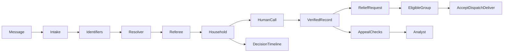

# Ekata

**One verified household record, from first SOS to relief and appeal checks.**

Built by TheByteForce during AI Hackathon 2026 at the University of Moratuwa. All demonstration households, contacts, organisations and bulletins are fictional.

## Run

Use Linux or WSL with Jac **0.37.25**. Keep the checkout in the Linux filesystem.

```bash
jac install
export GEMINI_API_KEY="your-local-key"
jac run --dev
```

For a deterministic demonstration use `export EKATA_AI=off` before starting. For model-backed operation use `EKATA_AI=on`. Never commit keys or `.env` files.

Open the local address printed by Jac:

- `/#/citizen`: send an SOS, track its reference, read bulletins and check appeals.
- `/#/officer`: select a division, verify households by phone and request relief.
- `/#/ngo`: accept, decline, dispatch and deliver requests for a registered group.
- `/#/district`: monitor escalations, appeals, agent activity and evaluation.
- `/?ops#/officer`: guided demonstration controls. Start over resets synthetic demonstration data.

## Seven-step demonstration

1. An SMS and a relative's WhatsApp become one household incident.
2. A different Perera household remains separate.
3. A missed call does not verify the household; a successful call does.
4. A boat request goes to an eligible registered group. Its decline triggers reassignment.
5. The next group accepts and dispatches; the citizen can see that help is on the way.
6. An appeal through the registered channel matches the verified household. An unregistered payee plus an OTP request triggers analyst review.
7. The group records delivery. Citizen tracking updates to Help delivered. Open the household story and Jac graph to inspect evidence, agent proposals, rules, human decisions and actions.

The operator panel supplies fictional messages and recorded human actions to the real application pipeline. In rules mode, the demonstration does not claim live model inference.

## Why Jac and Jaseci

Messages, identifiers, incidents, calls, appeals and resource requests share a persistent graph anchored explicitly on `root.shared`. Walkers find candidates through shared identifiers. The resolver uses `visit ... by llm` to choose a graph neighbour and a typed scoring function to assess the household match. Typed `by llm` functions perform intake, briefing and resource matching. Tool-using agents inspect read-only evidence. Plain Jac referee rules constrain automatic actions, while humans verify calls and review consequential findings. Decision nodes preserve the reasoning and outcome; `commit()` makes each completed unit visible to other requests. The frontend is also written in Jac.



Key modules: `coordinator`, `blocking`, `referee`, `portal`, `casework`, `timeline`, `scenario`, `memory`, `geo`, and `evaluation` under `ekata/`.

## Validation and evaluation

```bash
jac check .
jac test ekata
jac run --faux
jac run --no-serve --no-takeover tools/evaluate.jac --mode rules
```

Evaluation reads raw messages first and opens the separate truth labels only after predictions are produced. Results identify the engine and dataset. The bundled storm night is development data, not independent held-out evidence. A separately authored set can be supplied with message and label paths; use `--held-out` only when that independence is true. No production-performance claim is made.

## Practical boundaries

- Role selection is a demonstration workflow, not authenticated production authorisation.
- An unverified appeal is not evidence of fraud; public warnings require review.
- Map locations inferred from a division are approximate. Road routing does not establish flood-safe access; straight-line fallback estimates are labelled.
- Human decision precedents are retrieved graph memory, not model fine-tuning.
- A recorded model run must be labelled; unseen inputs may still invoke the live provider.
- Real deployment requires access controls, verified relief registries, operational data feeds and field validation.

MIT licensed. See [LICENSE](LICENSE).
